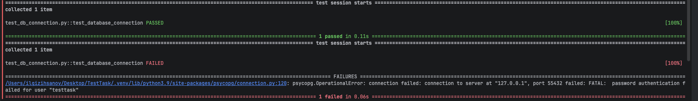

# Тестовое задание МодульБанк

## SQL

В файле `sql/solutions.sql` представлены решения задач:

1. Клиенты из Новосибирска, зарегистрированные в 2025 году.
2. Количество открытых счетов по валютам.
3. Общая сумма входящих транзакций каждого клиента.
4. Клиенты без счетов.
5. Клиенты, у которых больше двух счетов.
6. Поиск дублирующихся транзакций.
7. Топ-3 клиентов по сумме исходящих транзакций за каждый месяц.

## Автотест pytest

Тест `test_db_connection.py` подключается к PostgreSQL, выполняет
`SELECT now()` и проверяет полученный результат

## Стэк

Python 3, pytest, psycopg, PostgreSQL 17, Docker Compose.

## Демонстрация

С верными параметрами подключения тест проходит

С неверным паролем тест падает с ошибкой `password authentication failed`

